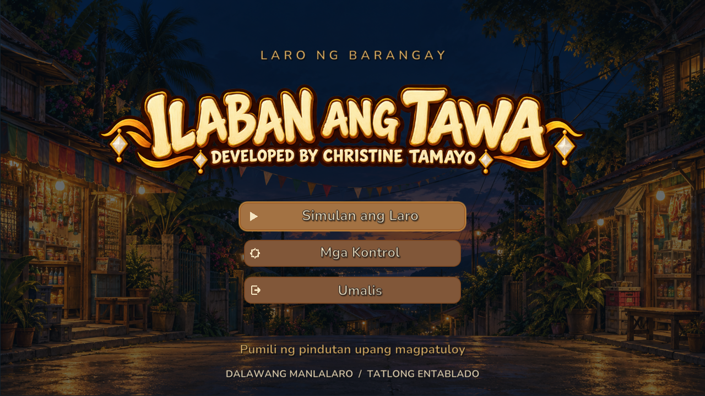
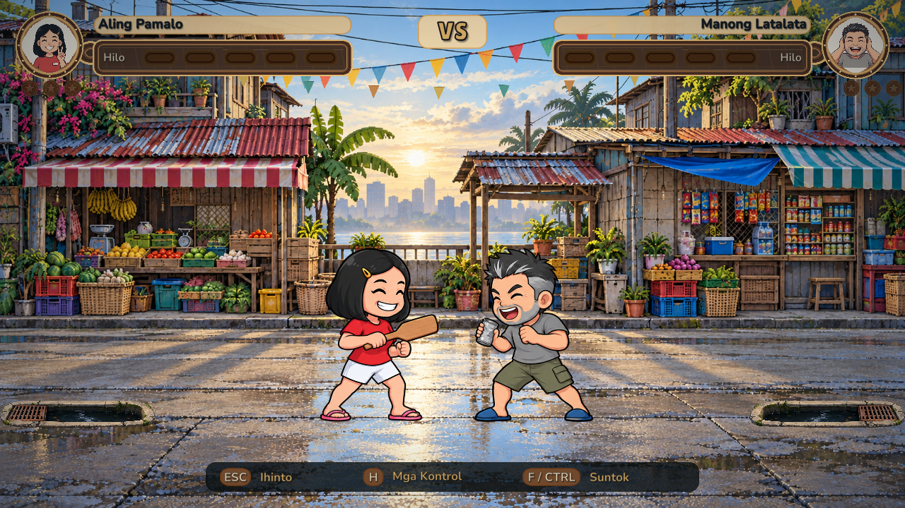

# ILABAN ANG TAWA DEVELOPED BY CHRISTINE TAMAYO

A two-player Filipino street brawler made by Christine Tamayo. Pick a character, choose one of three barangay arenas, and push your rival into the open kanal. The game is Tagalog-first and runs as a portable Windows app.

## Preview

**Pamagat**

**Laban sa Kalye ng Palengke**

## UPDATE2 release status

The requested UI fixes, original chibi head revisions, first-to-three match, five-option pause, error notices and whole-body emotes are implemented. Final verification and one-file packaging are in progress. Published v1.0 files and their old hashes are historical; consult SUBMISSION/FILE_INFO.txt after UPDATE2 delivery verification.

The requested Canvas file is **ILABAN ANG TAWA DEVELOPED BY CHRISTINE TAMAYO.exe**, one portable file. It must pass independent fresh-folder tests and Defender before recommendation. Keep the complete Windows folder/ZIP as backup; never submit its inner Unity EXE without companion files.

[PUBLIC source repository](https://github.com/Tinenen-cs/ILABAN-ANG-TAWA-DEVELOPED-BY-CHRISTINE-TAMAYO).
[Drive folder](https://drive.google.com/drive/folders/1g1_TxVdJFwQab1QGKS9eUD65fRjbtfbH).

## Controls

- **Manlalaro 1:** A / D to move; F to punch and confirm.
- **Manlalaro 2:** Left / Right arrows to move; Right Ctrl or Numpad 0 to punch and confirm.
- **Gamepad:** left stick or D-pad to move; A / X to punch and confirm; B to go back. The first connected controller controls P1 and the second controls P2.
- **ESC:** pause or return from a menu. **H:** open controls during a match. **Alt+Enter:** toggle fullscreen and windowed mode.

## Game rules

Movement is left and right only. Every player has the same straight punch. A landed hit moves the target back exactly one step. Five consecutive hits make the target dizzy for two seconds; a miss, a three-second gap or being hit resets the streak. The round ends immediately when a player falls into the kanal. First to three round wins takes the match; earlier rounds advance automatically. All eight use 190-unit reach, .12-second startup, .36-second cycle and one 52-unit step per hit. The five-segment Hilo meter tracks landed-hit streak, never health. There are no health bars, knockout system, jump, kick, extra move or match timer.

## Submit in Canvas

UPDATE2 single-EXE verification is pending. Do not submit the older elevation-dependent SFX. Current exact size/hash and delivery links will be recorded in SUBMISSION/FILE_INFO.txt only after fresh-folder launch and full three-win match checks.

## Requirements and credits

- Windows 10 or Windows 11, 64-bit.
- Two keyboard players share one computer, or connect compatible gamepads.
- See [CREDITS.md](CREDITS.md) for character, stage, font and audio credits; see [AUDIO_LIST.md](AUDIO_LIST.md) for cue details.

## Project verification

The source is developed with Unity 6000.6.2f1. Automated test, build, screenshot and package evidence is recorded under `Docs/QA_EVIDENCE/`, `Docs/portable_qa_results.json` and `Docs/QA_EVIDENCE/final_summary.json`. `Docs/package_verification.json` verifies the current ZIP, fresh extraction and complete simulated match. Optional SFX rejection and desktop/Defender results are recorded under Docs. Physical keyboard/controller/clean-PC/audio tests remain manual. See [CHECKLIST.md](CHECKLIST.md) for verified and manual items.
